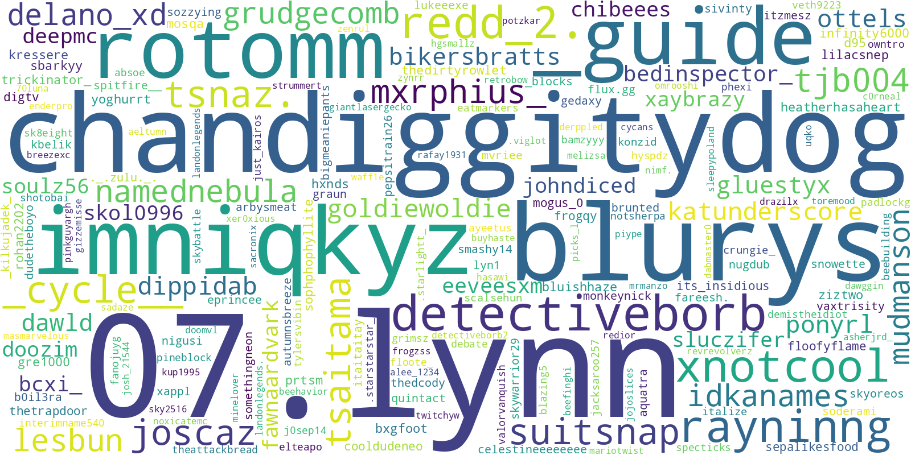
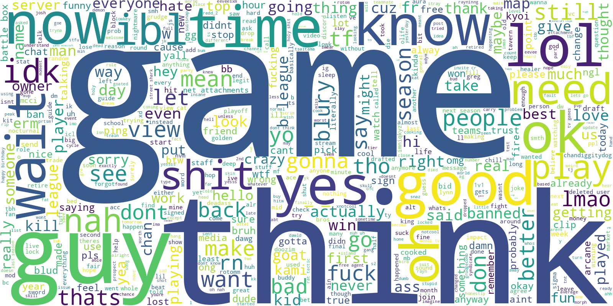
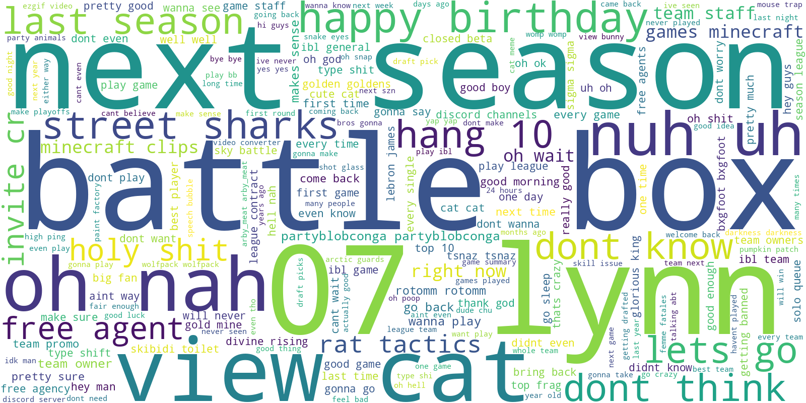
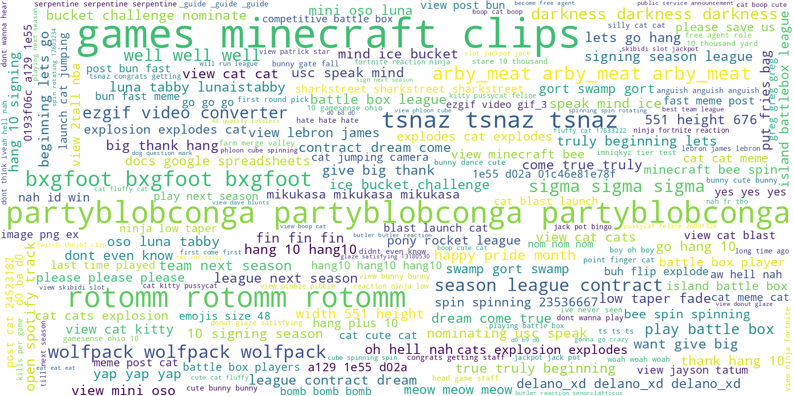

# Discord Message Word Clouds

A personal data analytics project I made for fun. I analyzed more than 600,000 messages from a community Discord server and turned the most frequent words, two- and three-word phrases, and mentioned people into word clouds. The data covers September 2023 to September 2025.

> **A note on context:** This was a Minecraft-related Discord server, so some of the words and phrases may be unfamiliar without that context.

I extracted the data using the Discrub Chrome extension. The goal was to explore what came up most often in the server's conversations and make the results easy to browse visually.

I also used Flourish to make a racing bar chart showing cumulative messages over the dataset's date range.

## Tools

The analysis scripts use Python with pandas, WordCloud, matplotlib, and scikit-learn. The racing bar chart was made with Flourish. The repository includes processed data and generated images, so you can view the word clouds without running the scripts.

## Word clouds

The generated images are in [`word_clouds/`](word_clouds/):

### Who was the most popular?!



### What were the most common words?



### Thse most common two word phrases?



### Three word phrases?



## And who were those chatters?

[https://github.com/user-attachments/assets/e5f7c761-2c49-46e8-b4fb-75e5e33c809a](https://github.com/user-attachments/assets/e9528059-a2c8-439f-abee-b9c3086007d4)

## How it works

The exported Discord message data is stored as JSON files in [`general_messages/`](general_messages/). The scripts in [`scripts/`](scripts/) combine and reshape the data, extract message text and mentions, count words and phrases, and generate the word cloud images.

The phrase analysis uses common and project-specific stop words to reduce noise. Long numeric strings are also removed before phrase counting.

## Project layout

```text
general_messages/   Exported Discord message JSON files
processed_csvs/     Combined and derived CSV data
scripts/            Data processing and word cloud scripts
word_clouds/        Generated word cloud images
```

## Running the scripts

Install the required Python packages (`pandas`, `wordcloud`, `matplotlib`, and `scikit-learn`), then run the workflow from the project root:

```bash
python main.py
```

This runs the scripts in order: consolidate the JSON files, extract mentions and message text, then generate the mentioned-user, individual-word, and two- and three-word phrase clouds.

The script to generate the data formatted for Flourish is optional. To run it, uncomment the `get_and_filter_date` import in `main.py` before the mention and message processing steps.
